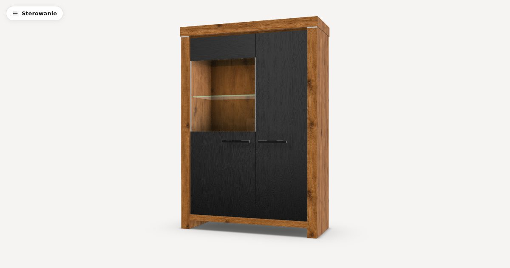

# 3D cabinet configurator

A web configurator for a two-section living-room cabinet. Change the size, finishes, glazing and handles, and the 3D model and the price update live. The UI is in Polish and prices are in PLN.

Live: https://konfigurator-3d.sebrogala.dev (deployment in progress, so the link may not respond yet).



This is a frontend proof of concept. Prices come from a mock catalog; a headless Medusa.js backend is planned for a later stage.

## Features

- Parametric cabinet: width 900–1300 mm and height 1600–1800 mm, set by slider or numeric input in 50 mm steps. Panels, doors, shelves and glass rebuild from the chosen size.
- Section split: a wide glazed section, or two equal sections.
- Body in three wood finishes; fronts in standard colours, premium colours or wood veneer.
- Glazed door on the left, on the right or none, with clear or smoked glass.
- Three handle styles: black bar, brushed steel bar, push-to-open.
- Live total price in a sticky header and a summary of every choice.
- PBR rendering: wood textures (CC0 scans and one project-made texture), a studio HDRI, neutral tone mapping, a soft footprint shadow.
- Orbit camera with limits that refits after every size change; renders on demand only.
- "Sterowanie" viewer panel: camera presets (front, 3/4, side), animated doors that open and close, a PNG snapshot, and fullscreen.

## Run it

Node.js with npm:

```bash
cd frontend
npm install
npm run dev        # http://localhost:5173
```

Docker, with a shared Traefik stack on an external `infra` network:

```bash
docker compose up -d --build                                      # https://konfigurator.dev.localhost
```

Docker, standalone:

```bash
docker compose -f docker-compose.standalone.yml up -d --build    # http://localhost:5173
```

[DEPLOY.md](DEPLOY.md) covers the production image and the deployment.

## Checks

From `frontend/`:

```bash
npm run build      # type-check and production build
npm run lint       # oxlint
npm test           # node:test unit tests for pricing and cabinet resolution
```

Browser checks with Playwright live in `frontend/scripts/`. Playwright is not a project dependency; each script's header states how to run it.

- `scene-check/shoot.mjs` renders `scene-check.html` in a set of cabinet configurations and saves screenshots.
- `scene-check/interact.mjs` checks the camera refit on resize and the orbit limits.
- `ui-check/check.mjs` opens every step, picks every option, checks the total, and checks the summary.

## Stack

React, TypeScript, Vite, three.js through React Three Fiber, and drei. Exact versions are in [frontend/package.json](frontend/package.json). Production serves the static build with nginx.

## Architecture

Code lives under `frontend/src/`:

- `contract/` holds `ResolvedCabinet`, the seam between the configurator and the 3D scene. The scene renders a `ResolvedCabinet` and knows no prices or option ids.
- `model/` is pure TypeScript with no React, three.js or I/O: the catalog types, the rules, `resolveCabinet` and the pricing functions.
- `catalog/` is replaceable data: one mock `Catalog` value, passed into the app as an argument. A later stage swaps its source for the Medusa API without touching the model or the UI.
- `ui/` holds the steps, swatches, header and summary. `scene/` holds layout, geometry, materials, camera and lighting.

Pricing uses a surcharge model: the total is a base price, plus a flat rate per step for each dimension above its minimum, plus one flat surcharge for each selected option's group.

Viewer controls reach the scene through a second seam, `contract/sceneControls.ts`, and stay out of the selection and the price.

Details are in [docs/3d-configurator/architecture.md](docs/3d-configurator/architecture.md).

## Key decisions

- **Geometry built in code, not a fixed model file**: width, height and door layout must change live.
- **Millimetres in the configuration model**: furniture is specified in millimetres; the scene converts to metres.
- **Sizes as stepped ranges**: a flat rate per 50 mm step keeps size pricing inside the surcharge model and limits sizes to fixed steps.
- **View state outside the configuration**: camera, doors, snapshot and fullscreen never change the selection or the price.
- **Surcharge pricing instead of one variant per combination**: the combinations would number in the thousands.
- **Catalog as an input**: swapping the mock for a backend touches one place.
- **Door glass uses transparency instead of transmission**: a transmissive pane hid the glass shelf behind it.
- **Custom footprint shadow**: drei's `ContactShadows` drew nothing on the installed versions.

The full record of decisions and pitfalls is in [docs/3d-configurator/](docs/3d-configurator/README.md).

## Roadmap

- Next: LED lighting in the glazed section as a priced option, and the configuration encoded in a shareable URL.
- Later: a Medusa.js backend that holds the catalog, prices the configured cabinet on the server and adds it to a cart.

## Credits

The studio HDRI and two wood textures are CC0, from Poly Haven and ambientCG. The `oak-rustic` texture was AI-generated by the author and is MIT-licensed with the repository. The asset list is in [frontend/public/textures/SOURCES.md](frontend/public/textures/SOURCES.md).

## License

[MIT](LICENSE) © 2026 Sebastian Rogala
